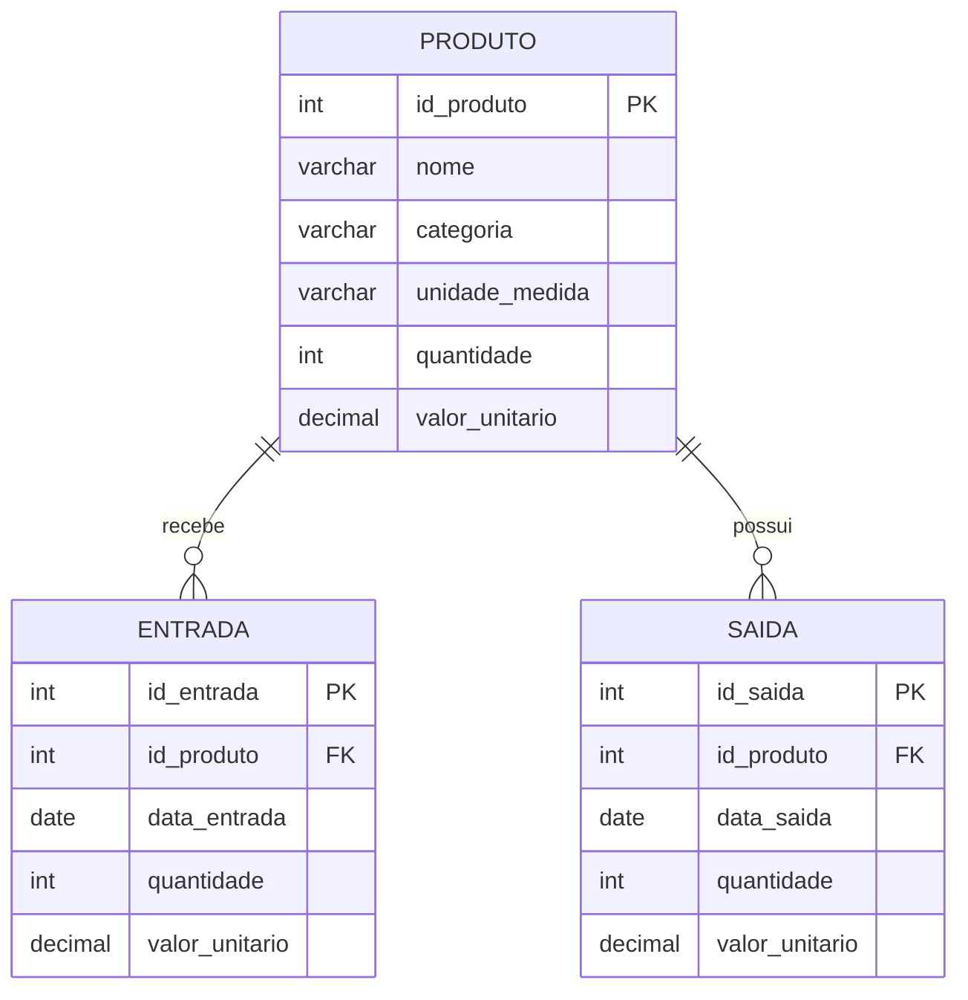

# DER - Controle de Almoxarifado

## Cardinalidades
- `categoria` é um atributo do PRODUTO (texto obrigatório).
- PRODUTO 1 : N ENTRADA (cada entrada refere-se a um produto).
- PRODUTO 1 : N SAIDA (cada saída refere-se a um produto).

`PRODUTO.quantidade` é o saldo atual, atualizado automaticamente a cada entrada/saída.
`valor_unitario` em ENTRADA/SAIDA guarda o preço praticado na movimentação.
